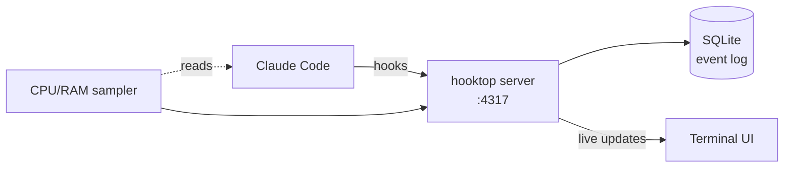

# hooktop


**See what Claude Code is really doing: every tool call, every subagent, what it costs your machine, and what it would cost in tokens, live in your terminal.**

hooktop is for developers who code with agents and want to look under the hood. When Claude Code runs, it reads files, greps, edits, runs your tests and sends off subagents, often faster than you can follow. hooktop shows all of it as it happens, in a nutshell:

- **Tool calls:** which tools Claude used, on what, in what order, and how long each one took.
- **Subagents:** who Claude sent off to do what, and how their work fits into the session.
- **Hardware:** the CPU and memory used by Claude Code and everything it started, matched to the tool call that caused it.
- **Cost:** tokens and their price for every prompt, turn and subagent, by model, at API list prices.

It's one small Rust binary that runs on your machine. Nothing leaves your computer.


## Quick start

```sh
brew install nazliander/tap/hooktop   # or: cargo install --locked hooktop
hooktop hooks install                 # point Claude Code at hooktop (backs up settings.json first)
hooktop                               # open the terminal UI
```

Start `claude` in another terminal and the session shows up on the left. To look around first, run `hooktop --demo`.

Building from source needs Rust 1.88 or newer.

## The cast

- **🦊 Watcher** is the Boss: Claude's main agent.
- **♞ Followers** are the subagents Watcher sends out (Explorer, Planner, Squire, …).
- **Connections** are your Claude Code sessions: open while Claude works or waits for you, and closed when the session ends or after an hour of quiet. A closed connection reopens if Claude picks it up again.

## How it works



Claude Code sends each event (a prompt, a tool call, a subagent starting or stopping) to hooktop. hooktop builds a graph per session, saves the raw events, measures the CPU and memory of Claude Code and everything it starts, and reads token usage from Claude Code's transcript. The terminal UI shows it all live. The technical details are in [docs/architecture](https://github.com/nazliander/hooktop/blob/main/docs/architecture/README.md).

## About the costs

Costs are what the same tokens would cost through the Claude API, from [Anthropic's price list](https://platform.claude.com/docs/en/about-claude/pricing). On a Claude subscription you don't pay per token, so treat them as a measure of how heavy a session was. hooktop reads the token counts from Claude Code's own transcript and keeps only the numbers, never the text. To price a model hooktop doesn't know yet, add it to `prices.json`; see [docs/architecture/costs.md](https://github.com/nazliander/hooktop/blob/main/docs/architecture/costs.md).

## Three tabs

Press `o` to move between them.

- **Timeline:** CPU and RAM charts, the party (Watcher and its Followers), and the history of prompts, turns and tool calls on one time axis, with what each one cost.
- **Graph:** tasks as nodes and edges; Enter on a node lists its tool calls.
- **Statistics:** where the time went (Claude thinking, tools running, waiting for you), each tool's calls and time, cost by model, the slowest calls and prompts, the biggest RAM and CPU users, and how long each Follower ran. Repeated commands are grouped (`×3`), and calls that start a Follower are left out of the slowest list, since the Followers ranking shows them. Press `Tab` to pick a panel and `Enter` on a row to see what's behind it: every call of a tool, the longest thinking stretches and what came before and after them, where a model's cost went, a call's full details. `Enter` on an item shows it in the Timeline.

| Graph | Statistics |
|---|---|
|  |  |

## Keys

| Key | What it does |
|---|---|
| `o` / `O`, `s` | Next / previous tab, Statistics |
| `↑ ↓ → ←` or `j k l h` | Move, open and close |
| `Enter` | Open a row or node; on a tool call that sent a Follower, jump to it |
| `Esc` | Back to Watcher |
| `Tab`, `Enter` on Statistics | Pick a panel; see what's behind a row, then `Enter` again to find it in the Timeline |
| `f` | Follow the connection Claude is working in |
| `x` / `X` | Remove this connection / all closed and quiet ones (asks first) |
| `e` / `c` | Open / close everything |
| `n` | Show or hide notifications |
| `d`, `[` | Show or hide details, connections |
| `t` | Theme: Ayu Dark or Ayu Light |
| `?` / `q` | Help / quit |

## Commands

| Command | What it does |
|---|---|
| `hooktop` | The terminal UI (attaches to a running hooktop, or runs one while open) |
| `hooktop serve` | Server only, to record in the background. Stops after 1 hour unused (`--idle-timeout 30m`, or `off`) |
| `hooktop --close-after 30m` | Close quiet connections sooner (default 1 hour, `off` to keep them open); works for `hooktop serve` too |
| `brew services start hooktop` | Runs the server at login and keeps it running |
| `hooktop --demo` | Play a made-up session |
| `hooktop hooks install` / `uninstall` | Add or remove hooktop's hooks |
| `hooktop export <id>` / `hooktop serve --replay <file>` | Export a session as JSONL / play one back |
| `hooktop token rotate` | Make a new token; a running hooktop and your hooks switch over by themselves |
| `hooktop reset` | Delete stored history (stop hooktop first) |

Run `hooktop --help` for every flag.

## Settings

hooktop reads `config.json` next to its event store (`~/Library/Application Support/hooktop/` on macOS, `~/.local/share/hooktop/` on Linux):

```json
{ "automated_prompts": ["[Subagent hand-back]"] }
```

`automated_prompts` lists prefixes of messages your own tooling sends as prompts. They still show in the history, but Statistics doesn't count them as your prompts. `--automated-prompt <PREFIX>` does the same for one run.

## Security

hooktop only listens on your own machine, and every request needs a secret token that `hooktop hooks install` gives to Claude Code. Requests from web pages are refused, so a site you visit can't read your sessions or add fake ones. hooktop's files are readable only by you. Details are in [docs/architecture/security.md](https://github.com/nazliander/hooktop/blob/main/docs/architecture/security.md).

## Contributing

Issues and pull requests are welcome; see [CONTRIBUTING.md](https://github.com/nazliander/hooktop/blob/main/CONTRIBUTING.md). Please report security problems privately, as described in [SECURITY.md](https://github.com/nazliander/hooktop/blob/main/SECURITY.md).

## Development

```sh
cargo test
cargo clippy --all-targets -- -D warnings
cargo run -- --demo --no-store
```

To release:

1. Add notes under **Unreleased** in [CHANGELOG.md](https://github.com/nazliander/hooktop/blob/main/CHANGELOG.md) as you go.
2. Run `packaging/release.sh 0.1.3`. It moves those notes under the new version and bumps the crates.
3. Commit, push, and push a matching tag (`git tag v0.1.3 && git push origin v0.1.3`, or create a release on GitHub).

GitHub Actions builds macOS and Linux binaries, publishes the GitHub release with the changelog notes, updates the Homebrew tap and publishes to crates.io.

## License

The code is Apache-2.0: see [LICENSE](https://github.com/nazliander/hooktop/blob/main/LICENSE) and [NOTICE](https://github.com/nazliander/hooktop/blob/main/NOTICE). The knight artwork is © Nazli Ander, licensed [CC BY 4.0](https://github.com/nazliander/hooktop/blob/main/docs/ARTWORK.md).
