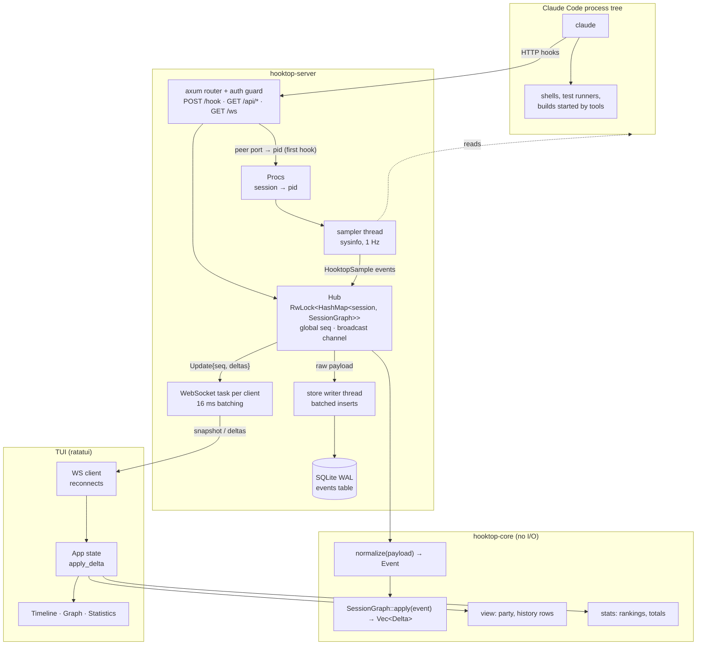

# hooktop architecture

hooktop is one Rust binary, `hooktop`, built from two crates. It receives Claude Code's HTTP hooks, folds them into a graph per session, stores the raw events in SQLite, samples CPU and memory of Claude Code's process tree, and streams changes over a WebSocket to the terminal UI.

| Document | Covers |
|---|---|
| This page | Components, crates, data flow, storage |
| [Events and the session graph](events-and-graph.md) | Hook events, normalization, tasks, edges, deltas |
| [CPU, RAM and connection lifecycle](resources.md) | Finding Claude Code's process, sampling, closing dead sessions |
| [HTTP and WebSocket protocol](protocol.md) | Endpoints, messages, batching, removal |
| [Terminal UI](tui.md) | Attach vs embedded, event loop, views, graph layout |
| [Token usage and cost](costs.md) | Reading usage from transcripts, matching it to tasks, the price table |
| [Security](security.md) | Who could reach the server, the token, browser and DNS-rebinding defences, file permissions |

## Components



## Crates

| Crate | Modules | Notes |
|---|---|---|
| `hooktop-core` | `event` (payloads, `normalize`, `Sample`), `graph` (`SessionGraph`, `Delta`), `view` (party, history rows, formatting), `stats`, `prompt`, `summary` | Pure and deterministic: the same events always give the same graph. |
| `hooktop-server` | `http`, `ws`, `hub`, `store`, `procs`, `server`, `hooks`, `demo`, `tui/*`, `main` | The `hooktop` binary. Server, TUI and CLI. |

## Data flow for one hook

1. Claude Code POSTs a JSON payload to `/hook` (body limit 32 MB; tool responses can be large). The [auth guard](security.md) checks the token, `Origin`, `Host` and content type first.
2. On a session's first hooks, `http` looks up the sending process from the TCP peer address and records it in `Procs` ([details](resources.md)).
3. `Hub::ingest` takes the write lock, assigns the next global sequence number, normalizes the payload into an `Event`, and applies it to the session's `SessionGraph`, which returns `Delta`s.
4. Still under the lock, the raw payload is queued for the store writer and an `Update { seq, deltas, summary }` is broadcast. Doing all three under one lock guarantees that every subscriber sees deltas in `seq` order.
5. The hook gets `{}` back. hooktop never changes what Claude Code does.
6. Each WebSocket task collects updates for its subscribed session and flushes them every 16 ms ([protocol](protocol.md)).

## Storage

```sql
CREATE TABLE events (
    seq        INTEGER PRIMARY KEY,   -- global, monotonic
    at_ms      INTEGER NOT NULL,      -- receive time
    session_id TEXT    NOT NULL,
    hook       TEXT    NOT NULL,      -- hook_event_name
    payload    TEXT    NOT NULL       -- the raw JSON
);
CREATE INDEX events_by_session ON events (session_id, seq);
```

- The database lives at `<data dir>/hooktop/events.db` (`~/Library/Application Support` on macOS, `~/.local/share` on Linux), in WAL mode with `synchronous = NORMAL`. Override it with `--db` or `HOOKTOP_DB`, or skip it with `--no-store`.
- A dedicated writer thread receives messages over a channel and writes appends in batches of up to 1024 per transaction. Deletes travel through the same channel, so they apply after any appends queued before them.
- **Raw payloads are stored, not graphs.** On startup every event is replayed through `normalize` and `apply`, so improvements to the grouping logic apply to old sessions. Unknown fields are kept in `HookPayload::extra`, so nothing is lost.
- hooktop's own events use the same table: `HooktopSample` for CPU/RAM readings and a synthetic `SessionEnd` (reason `process exited`) when Claude Code dies. They export and replay like real hooks.

## Concurrency

| Thread or task | Work |
|---|---|
| tokio runtime | HTTP handlers, one task per WebSocket client, the TUI's network client, the idle watcher (`--idle-timeout`) |
| `hooktop-store` | SQLite writes |
| `hooktop-sampler` | Process refresh once a second; liveness check every 5 s |
| TUI input thread | Blocking `crossterm` reads, forwarded to the event loop |

The hub uses a `std::sync::RwLock`: ingest holds the write lock for microseconds, and snapshots clone a graph under the read lock. The broadcast channel holds 4096 updates; a client that falls further behind gets `resync` and a fresh snapshot.

## Performance

The release binary is about 6 MB with LTO and stripping. A hook is acknowledged in about 1 ms (p50), and hooktop ingested and stored 20,000 hook events in 6 s, with the test client as the bottleneck.
