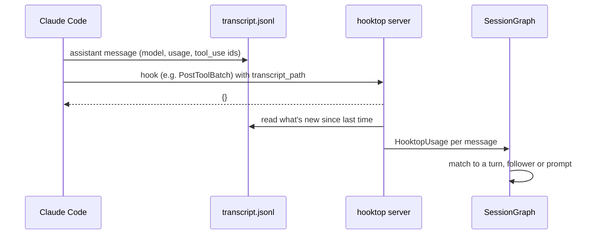

# Token usage and cost

hooktop shows what a session cost: per prompt, turn and follower, per model, and in total. These are **API list prices**: what the same usage would cost through the Claude API. On a Claude subscription you don't pay per token, so read them as a measure of how heavy a session was.

## Where the numbers come from

Hooks don't carry token counts. Every hook does carry `transcript_path`, the JSONL file where Claude Code records the session, and `SubagentStop` adds `agent_transcript_path` for the follower's own transcript. Each assistant message there has its model and a `usage` block.



- **When.** After a hook, off the request path. Always after `PostToolBatch`, `Stop`, `SubagentStop` and `SessionEnd`, where final numbers land; after other hooks at most every 1.5 s per file.
- **What.** Only complete lines appended since the last read. From each assistant message hooktop keeps the message id, model, timestamp, the token counts (input, output, cache read, 5-minute and 1-hour cache writes), whether it ran in fast mode or with US data residency, the ids of the tool calls it made, and the agent id. **Never the message text.**
- **Merging.** Claude Code writes one line per content block, all with the same message id. Lines are merged by id, keeping the largest counts, so each model call counts once. After a restart the transcript is read again from the start; usage that's already recorded with the same numbers is skipped.
- **Where it may read.** Only `.jsonl` files inside Claude Code's config folder (`~/.claude`, or `$CLAUDE_CONFIG_DIR`), after resolving `..` and symlinks. A hook can't point hooktop at any other file.

## Matching calls to tasks

Each `Usage` is attributed when it's applied to the graph, in this order:

1. **By tool call.** If the message made tool calls, it belongs to the turn or follower that owns them.
2. **By agent.** A follower's message with no tool calls belongs to that follower.
3. **By time.** Otherwise it's the reply to the latest prompt started before it, which is how a prompt's final answer is counted.

A prompt's cost is its own messages plus every turn that answered it. Watcher's cost is everything except the followers.

## Prices

`hooktop-core/src/pricing.rs` holds the official table from [Anthropic's pricing page](https://platform.claude.com/docs/en/about-claude/pricing), in USD per million tokens:

| Model | Input | 5m cache write | 1h cache write | Cache read | Output |
|---|---|---|---|---|---|
| Fable 5.1, Mythos 5.1 | $10 | $12.50 | $20 | $0.25 | $50 |
| Opus 5.5 | $4 | $5 | $8 | $0.20 | $20 |
| Sonnet 5.5 | $2 | $2.50 | $4 | $0.10 | $10 |
| Haiku 5.5 (prompt ≤ 100K) | $0.10 | $0.125 | $0.20 | $0.01 | $0.50 |
| Haiku 5.5 (prompt > 100K) | $0.50 | $0.625 | $1 | $0.05 | $2.50 |

The full table also covers Fable 5, Mythos 5, Opus 5 and 4.x, Sonnet 5 and 4.x, Haiku 4.5 and Haiku 3.5.

- **Model ids** are normalised before lookup: `claude-sonnet-4-5-20250929`, Bedrock's `us.anthropic.claude-…-v1:0` and Vertex's `…@20250929` all find their row.
- **Haiku 5.5's tier** is per request, on the whole prompt (input plus cache reads and writes).
- **Fast mode** uses the fast input and output prices (Opus 5.5: $8 and $40), with cache prices scaled to match.
- **US data residency** (`inference_geo: "us"`) multiplies the call's cost by 1.1.
- **Unknown models** show their tokens with "no price" and are left out of the total.

### Adding or changing prices

Put a `prices.json` next to the event store (`~/Library/Application Support/hooktop/` on macOS, `~/.local/share/hooktop/` on Linux):

```json
{
  "claude-opus-6": { "input": 4, "output": 20 },
  "claude-sonnet-5-5": { "input": 2, "output": 10, "cache_read": 0.1 }
}
```

Missing cache prices follow the standard multipliers: 1.25× input for 5-minute writes, 2× for 1-hour writes, and 0.1× for reads. The terminal UI reads the file at startup and says in the footer if an entry can't be read.

## Where costs show up

- **Timeline:** the session total in the header, per member in the party, a Cost column in the history for prompts and turns, and a token breakdown in the details pane.
- **Statistics:** a Cost tile, cost and tokens by model, cost per prompt, and cost per follower.
