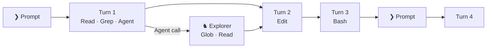
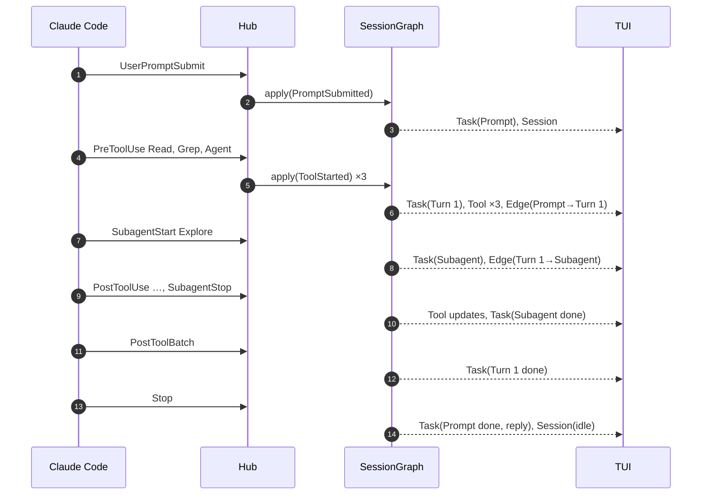

# Events and the session graph

## Hook events

`hooktop hooks install` adds an `http` hook (5 s timeout) for each of these events to `~/.claude/settings.json`, all posting to `http://127.0.0.1:4317/hook`:

`SessionStart`, `UserPromptSubmit`, `PreToolUse`, `PostToolUse`, `PostToolUseFailure`, `PostToolBatch`, `SubagentStart`, `SubagentStop`, `Stop`, `SessionEnd`, `Notification`.

Existing hooks are left alone, and the original file is backed up first. `hooktop hooks uninstall` removes only entries pointing at hooktop.

## Normalization

`event::normalize(payload, seq, at_ms)` turns a `HookPayload` into an `Event { seq, at_ms, session_id, agent_id, agent_type, cwd, kind }`:

| Hook | `EventKind` |
|---|---|
| `SessionStart` | `SessionStarted { source, model }` |
| `UserPromptSubmit` | `PromptSubmitted { prompt }` |
| `PreToolUse` | `ToolStarted { tool_use_id, name, input }` |
| `PostToolUse` | `ToolFinished { tool_use_id, name, response }` |
| `PostToolUseFailure` | `ToolFailed { tool_use_id, name, error }` |
| `PostToolBatch` | `ToolBatchDone` |
| `SubagentStart` / `SubagentStop` | `SubagentStarted` / `SubagentStopped { last_message }` |
| `Stop` | `Stopped { last_message }` |
| `SessionEnd` | `SessionEnded { reason }` |
| `Notification` | `Notification { message }` |
| `HooktopSample` (hooktop's own) | `Sample(Sample)` |
| `HooktopUsage` (hooktop's own) | `Usage(Usage)` |
| anything else | `Other` (stored, not drawn) |

`SubagentStart` and `SubagentStop` fire in the parent's context, so their `agent_id` names the child and is carried in the kind rather than as the event's source agent.

Prompt text is cleaned before display: `<system-reminder>` blocks and similar injected tags are stripped (`prompt` module), and slash commands, notifications and system messages get their own labels.

## The graph

A `SessionGraph` is a list of tasks, edges between them, and CPU/RAM samples. Tool calls are the subtasks inside a task.

| Task | Starts on | Holds | Ends on |
|---|---|---|---|
| **Prompt** (label `Prompt`, `Command`, `Notification` or `System`) | `UserPromptSubmit` | the prompt text, later Claude's reply | `Stop` |
| **Turn** | the first `PreToolUse` on the main thread | one assistant message's tool calls | `PostToolBatch` |
| **Subagent** (a Follower) | `SubagentStart`, or its first tool call | every tool call carrying its `agent_id` | `SubagentStop` |

Edges run prompt → turn → turn. A turn whose `Agent` (or `Task`) call spawned a subagent links to it, and the subagent links to the next main-thread turn. The spawning tool call records `spawned_task`, which the UI uses to jump to the Follower.

Details that keep the graph right with real-world event streams:

- **No `PostToolBatch`** (older Claude Code): a turn closes when a new tool starts after every earlier one has finished.
- **Duplicates** are harmless: tool calls are keyed by `tool_use_id`, and deltas are upserts.
- **Missing `tool_use_id`**: hooktop assigns an anonymous id and pairs the finish with the oldest running call of the same name.
- **Session end** marks anything still running as `interrupted`.
- **Samples** append to `samples` and deliberately don't touch `updated_ms` or status, so readings never reorder sessions or make an idle one look busy.

## One prompt, end to end

## Deltas

`apply` returns the minimal changes a client needs, and `apply_delta` applies them to a client's copy:

| Delta | Meaning |
|---|---|
| `session { status, title, cwd, model, updated_ms }` | session header changed |
| `task { task: TaskHeader }` | a task was created or changed (no tool list) |
| `tool { task_id, tool }` | a tool call was created or changed |
| `edge { from, to }` | a new edge |
| `sample { at_ms, cpu, rss, procs, top }` | a CPU/RAM reading |
| `usage { message_id, model, tokens…, task }` | one model call's tokens, attributed to a task; upserted by `message_id` ([details](costs.md)) |

All of them are idempotent, so a client that receives one twice ends up in the same state. Task ids are dense and assigned in order, so `tasks[id]` indexing stays valid on both sides.

## Views and stats

`hooktop-core::view` derives what the UI draws from a graph:

- `party(g)`: the Boss first, then Followers depth-first under whoever spawned them.
- `history_rows(g, agent, expanded, hide_notices)`: the flattened tree of prompts → turns → tool calls for the Boss, or one Follower's tool calls.
- `prompt_groups(g)`: each prompt with the turns that answered it.

`hooktop-core::stats::stats(g, now, top)` computes the Statistics tab: counts, wall time, summed tool time, tool mix and time per tool, the slowest calls, the longest prompts, Follower runs, and resource rankings ([how samples are attributed](resources.md#attributing-readings-to-tool-calls)).
