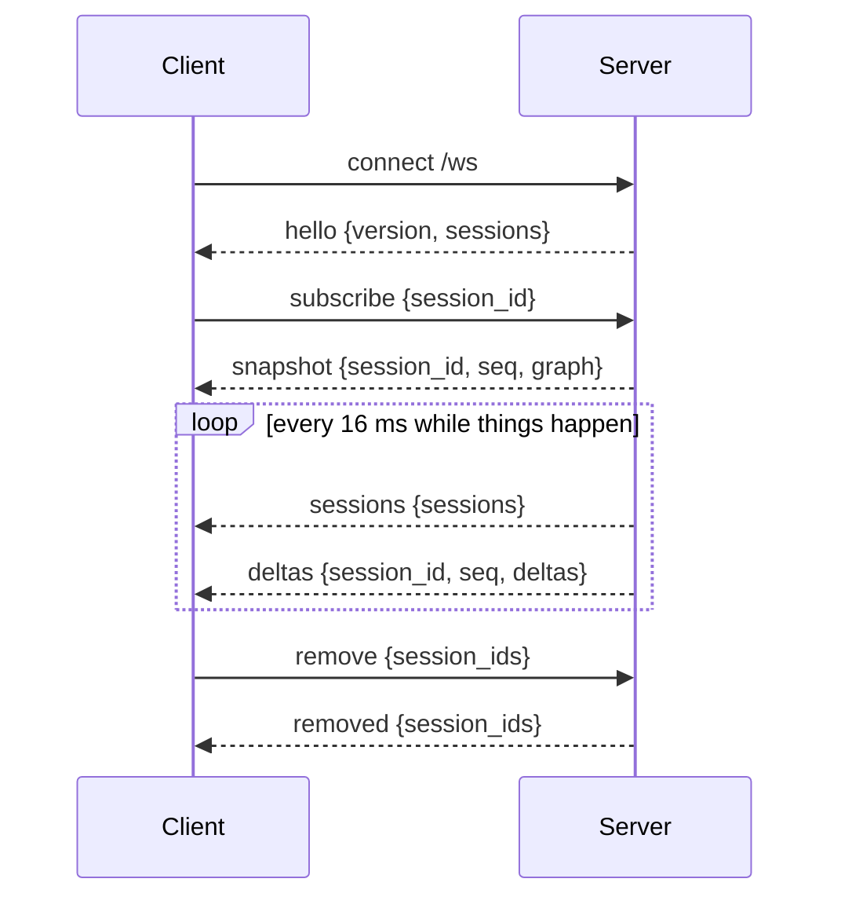

# HTTP and WebSocket protocol

The server listens on `127.0.0.1:4317` by default (`--host`, `--port`, `HOOKTOP_HOST`, `HOOKTOP_PORT`).

Every request, including the WebSocket handshake, needs `Authorization: Bearer <token>` and no `Origin` header, and must use a local `Host`. Refusals are `401` (token), `403` (`Origin`), `421` (`Host`) and `415` (a `/hook` that isn't `application/json`). See [Security](security.md).

## HTTP

| Method | Path | Returns |
|---|---|---|
| POST | `/hook` | `{}` on success. `400` for an unreadable payload, and for `HooktopSample` (only hooktop records those). |
| GET | `/api/health` | `{ ok, version, sessions, persistent }` |
| GET | `/api/sessions` | session summaries, most recently active first |
| GET | `/api/sessions/{id}` | `{ seq, graph }`: the full `SessionGraph` |
| GET | `/api/sessions/{id}/events?after=&limit=` | raw stored events (`limit` 1–5000, default 500); `404` with `--no-store` |
| GET | `/ws?session=&format=json\|msgpack` | the live feed |

Any other path is `404`.

## WebSocket

Connect to `/ws` with the `Authorization` header, optionally with `session=<id>` to subscribe immediately and `format=msgpack` for binary frames (JSON text is the default).

### Server → client

| `type` | Fields | When |
|---|---|---|
| `hello` | `version`, `sessions` | on connect, and after a resync |
| `snapshot` | `session_id`, `seq`, `graph` | on subscribe, or once a subscribed session first exists |
| `deltas` | `session_id`, `seq`, `deltas` | changes to the subscribed session |
| `sessions` | `sessions` | summaries of sessions that changed |
| `removed` | `session_ids` | sessions deleted by any client |
| `resync` | | the client fell behind; a fresh `snapshot` and `hello` follow |
| `error` | `message` | a client message couldn't be read, or the token was rotated (the socket then closes) |

### Client → server

| `type` | Fields | Effect |
|---|---|---|
| `subscribe` | `session_id` | switch the subscription; a snapshot follows if the session exists |
| `unsubscribe` | | stop receiving deltas |
| `remove` | `session_ids` | delete these sessions everywhere |
| `remove_stale` | `quiet_ms` | delete closed sessions, and open ones quiet for `quiet_ms` with no known live process |

### Ordering and batching

- Every update carries the global `seq` it was assigned under the hub's write lock. A client applies deltas only for seqs after its snapshot, so nothing is applied twice or skipped.
- The server subscribes to the broadcast **before** taking the snapshot, so no update falls between the two.
- Updates are collected and flushed every 16 ms, so a burst of parallel tool calls arrives as one frame.
- The broadcast channel holds 4096 updates. A client that lags further gets `resync`, a new snapshot and a new `hello`.
- The TUI reconnects with backoff (200 ms doubling to 2 s) and resubscribes when the connection comes back.
