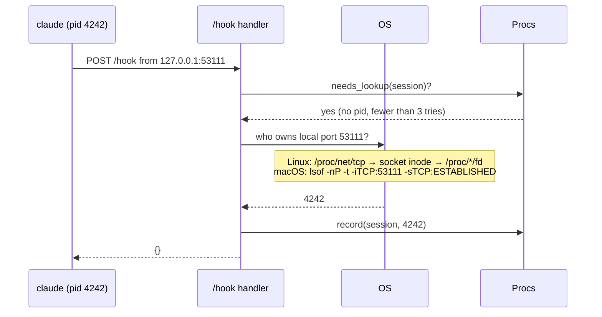
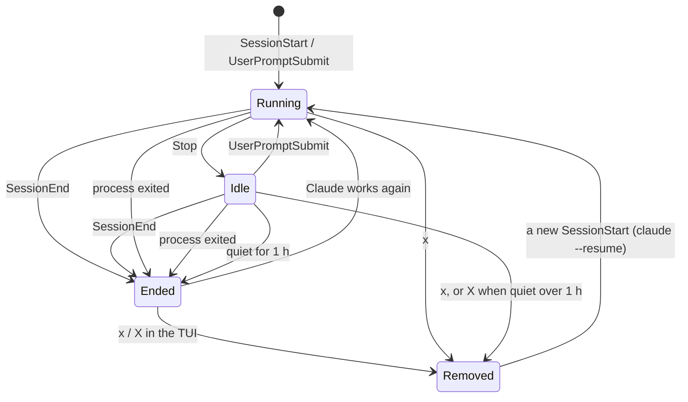

# CPU, RAM and connection lifecycle

Hooks carry no resource data, so hooktop measures it from the outside. The code is in `hooktop-server/src/procs.rs`.

## Finding Claude Code's process

Claude Code sends its HTTP hooks from its own process. While a hook request is in flight, the TCP connection is open, and its client end belongs to Claude Code.

- The lookup runs on a blocking thread before the hook is answered, so the connection is still open. It happens once per session: a few milliseconds with `/proc`, a few tens with `lsof`.
- Only loopback peers are looked up. After 3 failed tries (a replay, `curl`, a sender hooktop can't see) a session is left alone.
- On macOS both ends of the connection match the port, so hooktop skips its own pid.
- Other platforms compile, but without a lookup the charts stay empty.

## Sampling

A `hooktop-sampler` thread wakes once a second. For every session that is **working** (status `running`) and has a known pid, it:

1. refreshes all processes with `sysinfo` (CPU and memory only, no threads),
2. builds a parent → children map and walks the tree under Claude Code's pid,
3. sums CPU and resident memory, counts processes, and notes the busiest descendant by name (`cargo`, `node`, …),
4. ingests the result as a `HooktopSample` event, which is stored, broadcast as a `sample` delta and appended to `SessionGraph::samples`.

Nothing is sampled while a session waits for you, so a session left open overnight adds no rows. The thread holds only a `Weak<Hub>` and exits when the server stops.

**CPU** is measured by hooktop, not taken from `sysinfo`'s percentage, which can spike far past what the machine has (4000% on a 10-core Mac) for a process it sees for the first time. For each process, hooktop divides the CPU time it used since the previous reading by the time between the readings:

- A process counts from its second reading, so a new process shows 0 for its first second.
- No process, and no session, counts above the number of cores.
- The first reading after a quiet stretch averages over the whole gap; the next ones are per second.

The value is stored as a percentage of one core (100 = one core busy). The UI shows it as cores: `4.0 cores`.

## Connection lifecycle

In the UI these read as **Open · working**, **Open · waiting for you** and **Closed**.

**Dead processes.** Every 5 s the sampler refreshes just the tracked pids. If one is gone, the hub forgets it and ingests a synthetic `SessionEnd` with reason `process exited`, which interrupts anything still running. This catches closed terminals and crashes, where Claude Code never sends `SessionEnd`. Sessions restored from disk have no known pid until their next hook, so they can't be checked this way; `X` clears those once they've been quiet for over an hour.

**Quiet connections.** Every minute (and right after startup, so sessions restored from disk are caught too), the server closes connections with nothing heard for an hour (`--close-after`, `HOOKTOP_CLOSE_AFTER`, `off` to disable). It records a `SessionEnd` with reason `idle`, dated at the session's last activity so the list's order and "last seen" stay true. A session Claude is working in whose process is still alive is left open, since a long build sends no hooks. Any later activity (a prompt, a tool call, a subagent) reopens the connection.

**Removal.** `Hub::remove` drops the graph, forgets the pid, queues a delete in the store writer (after any appends already queued), and broadcasts the removal. The id is remembered: further events for it are dropped until a `SessionStart` arrives, so removing a session that is still talking doesn't leave a fragment behind, and resuming it starts clean.

## Attributing readings to tool calls

Readings are per session, not per tool, so the Statistics tab attributes them by time:

- A tool call gets every reading taken between its start and end: **peak RSS** (RAM eaters) and **average CPU** (CPU hogs).
- A call shorter than the sampling interval borrows the first reading within 1.5 s after it started. The rankings mark it **borrowed**.
- When calls run in parallel they share readings, so the rankings show what ran while the machine was busy rather than an exact split. A call with a reading taken while another call was running is marked **shared**.
- An unmarked entry had its readings to itself. Each entry carries this as `CallStat::reading` (`Own`, `Shared` or `Borrowed`); borrowed wins when both apply.

Treat a marked entry as a lead ("memory was high around then"), not as that call's own usage.
- **Busiest processes** counts how long each process name was the top consumer: each reading lasts until the next one, capped at 2 s so gaps while Claude waited don't count.
