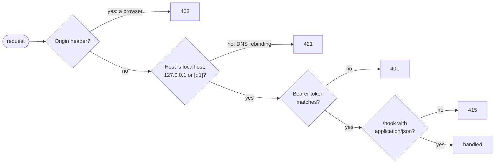
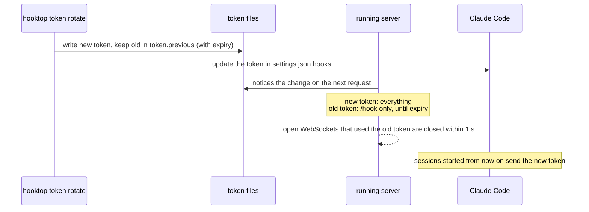

# Security

hooktop's data is sensitive: prompts, Claude's replies and tool output, which can include file contents, command output and secrets. It also accepts writes, since anything that can call `/hook` can add sessions and anything on the WebSocket can delete them. So the server is locked down even though it only listens on your own machine.

## Who could reach a local server

| Who | How | Without protection |
|---|---|---|
| Any web page you have open | `fetch`/form `POST` to `http://127.0.0.1:4317`, or `new WebSocket("ws://127.0.0.1:4317/ws")` | Inject fake sessions with a `text/plain` POST (no CORS preflight); read the whole live feed over a WebSocket (browsers don't apply CORS to WebSockets); delete history |
| A web page using DNS rebinding | Its own domain re-resolves to `127.0.0.1`, so its requests count as same-origin | Read `/api/sessions` and every event |
| Other processes and users on the machine | Connect to the port directly | Read and change everything |
| Other machines | Only if hooktop listens beyond loopback | Everything above, remotely |

Before these changes, the first two rows worked against a running hooktop: a POST from a foreign origin was accepted, a rebound `Host` read the session list, and a WebSocket with a foreign `Origin` was upgraded.

## The boundaries



Every route goes through `auth::guard`, an axum middleware:

1. **No browsers.** Browsers attach `Origin` to cross-site requests and to every WebSocket handshake. Claude Code's hooks and the TUI never send it, so any request with `Origin` gets `403`. This holds even when the token is right.
2. **Local host names only.** A `Host` other than `localhost`, `127.0.0.1` or `[::1]` (any port) gets `421`, which stops DNS rebinding. With `--allow-remote`, the `--host` name is accepted too.
3. **A token on every request.** `Authorization: Bearer <token>` is required on `/hook`, `/api/*` and `/ws`, compared in constant time; otherwise `401`.
4. **JSON hooks only.** `/hook` needs `Content-Type: application/json` (`415` otherwise). A page can only send that cross-site after a CORS preflight, and hooktop never answers one.

The process lookup for CPU/RAM sampling only runs after these checks, so unauthenticated requests can't make hooktop spawn `lsof`.

## The token

- On first run hooktop creates 32 random bytes (hex) in `<data dir>/hooktop/token`. The file is mode `0600` in a `0700` directory, and the token never changes on its own.
- `hooktop hooks install` writes `Authorization: Bearer <token>` into each hooktop hook in `~/.claude/settings.json`, and makes that file readable only by you. It's usually created readable by everyone (`644`), and macOS home folders let other accounts look inside. Running it again updates hooks that have an old token or none. If you share or commit that settings file, use `--token-from-env`, which writes `Bearer $HOOKTOP_TOKEN` and lets Claude Code fill it in from the environment.
- The TUI reads the same file and sends the token in the WebSocket handshake. When attached to a server started with a different token, it says so.
- `HOOKTOP_TOKEN` in the environment overrides the file, and `--token-file` points at a different one, for `hooktop serve`, `hooktop` and `hooktop hooks install` alike. There's no `--token <value>` flag on purpose: command lines are visible to every user through `ps`.
- At startup the TUI checks `settings.json`. If hooktop's hooks are missing or don't carry the token, it shows a warning in the footer, because refused hooks would otherwise make sessions silently stop appearing.

### Rotating the token

```sh
hooktop token rotate            # the old token may still send hooks for 12 h
hooktop token rotate --grace 1h # a shorter grace period
hooktop token rotate --now      # suspect a leak: cut the old token off at once
```



- **No restart.** The server compares the token files' modification time and size on each request, and re-reads them when they change.
- **Why a grace period.** Claude Code reads its hook settings when a session starts, so a session that's already running keeps sending the old token. Without a grace period those sessions would silently stop appearing in hooktop until restarted. During the grace period the old token can only **send hooks**: it can't read sessions or open the live feed.
- **Live connections.** Every WebSocket remembers the token it was opened with and re-checks it each second. After a rotation it gets an `error` message and is closed; the TUI re-reads the token file and reconnects by itself.
- **Hooks.** `rotate` updates hooktop hooks that carry the token in settings.json. Hooks using `$HOOKTOP_TOKEN` are left alone.
- **`HOOKTOP_TOKEN`.** When the token comes from the environment there's no file to rotate: change the variable and restart hooktop and Claude Code.
- **Leak response.** Use `--now`, then restart running Claude Code sessions. Remember that a token is only useful on your own machine, where whoever took it could probably read the database too.

`--no-auth` turns the token check off, for poking at the API with `curl`. The `Origin`, `Host` and content-type checks stay on, and hooktop logs a warning.

## Listening beyond this machine

`--host` defaults to `127.0.0.1`. hooktop refuses to start on any other address unless `--allow-remote` is given, and never with `--no-auth`. Hooks and the token travel in plain HTTP, so only do this on a network you trust, or put hooktop behind TLS.

## Not running when unused

`hooktop serve` stops by itself after an hour with nothing using it, so nothing listens while you're away. Use means a request that passed the checks above, an open hooktop window (WebSocket), or a session Claude is working in whose process hooktop is watching (a long build sends no hooks). Refused requests don't count, so nobody can keep hooktop running by poking at it. Change it with `--idle-timeout 30m` or `HOOKTOP_IDLE_TIMEOUT`, or turn it off with `--idle-timeout off`; the Homebrew service runs with it off, since it exists to keep recording. The terminal UI's own server lives exactly as long as the window.

While the server is down, Claude Code's hooks can't connect and those events aren't recorded. Claude keeps working; open `hooktop` again to resume recording.

## Data at rest

| File | Mode | Holds |
|---|---|---|
| `<data dir>/hooktop/` | `0700` | everything below |
| `events.db` (and `-wal`, `-shm`) | `0600` | every hook payload |
| `token` | `0600` | the shared secret |
| `hooktop.log` | `0600` | logs (no payloads) |
| `~/.claude/settings.json` | `0600` once it holds the token | the hooks, with the token |

`<data dir>` is `~/Library/Application Support` on macOS and `~/.local/share` on Linux.

## Who can still get the token

The token stops anything that can **send requests** to hooktop but can't **read your files**. It's not a defence against code already running as you.

| Who | Can they get in? | Why |
|---|---|---|
| A web page | No | Can't read files, can't guess 256 random bits, and is refused for sending `Origin` anyway |
| Another machine | No | hooktop only listens on loopback |
| Another user account on the same computer | No | The token file, settings.json and the database are readable only by you, and the token never appears in `ps` |
| A sandboxed app (App Store apps on macOS) | No | It may reach localhost but can't read your home folder |
| Any program running as you: a malicious package install script, an editor extension, a tool Claude runs | **Yes** | It can read the token file, or simply open the database directly |
| Root or an admin | **Yes** | They can read everything |

That last group can skip hooktop's server entirely and read `events.db`, so no token could stop them. It's the same trust boundary as your shell history, SSH keys and Claude Code's own transcripts in `~/.claude/projects`.

Claude itself counts as "running as you": with its file tools it could read hooktop's data folder. If that worries you, add a deny rule to Claude Code's permissions for the data folder (`~/Library/Application Support/hooktop` on macOS, `~/.local/share/hooktop` on Linux), knowing that shell commands can still reach it.

A leaked token on its own is worth little: it only works against loopback, so whoever holds it also needs to run code on your machine, and then they could read the database anyway.

## What this doesn't cover

- **Your own user account.** Any process running as you can read the token file, `settings.json` and the database. That's the same trust boundary as your shell history and SSH keys.
- **Volume.** A process with the token can send a lot of data. Hook bodies are capped at 32 MB each, but there's no rate limit.
- **Encryption at rest.** The database is plain SQLite. `hooktop reset` deletes it.
