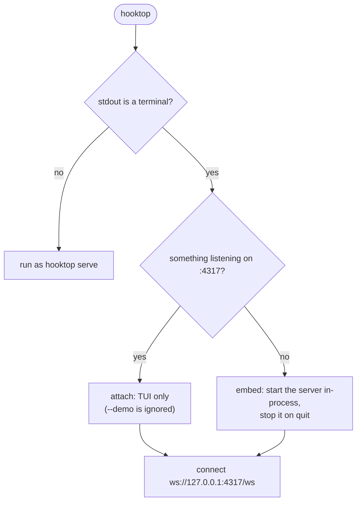
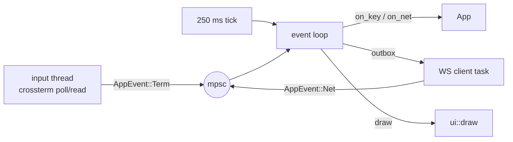

# Terminal UI

The TUI lives in `hooktop-server/src/tui/` and is built on ratatui with the crossterm backend.

| Module | Role |
|---|---|
| `mod.rs` | Startup (attach or embed), the event loop |
| `client.rs` | WebSocket client with reconnects; the `ServerMsg` types |
| `app.rs` | All state and key handling, with no terminal I/O, so it's unit-tested directly |
| `ui.rs` | Drawing: title bar, connections, the three tabs, details, help |
| `dag.rs` | Graph view layout, drawing and navigation |
| `theme.rs` | Ayu Dark and Ayu Light, with a 256-colour fallback |

## Attach or embed

Either way the TUI is a plain WebSocket client, so it behaves the same against `hooktop serve`, `brew services` or its own embedded server. It sends the token from `<data dir>/hooktop/token` (or `HOOKTOP_TOKEN`), and at startup checks that Claude Code's hooks carry that token, showing a footer warning if not. Logs go to `hooktop.log` next to the event store, never to the terminal.

## Event loop

Each iteration draws once, then waits for an event or the tick. Everything already queued is drained before the next draw, so a burst of updates costs one frame. The tick keeps live durations moving. Messages for the server (subscribe, remove) are queued in `App::outbox` and sent by the loop.

## State worth knowing

- **Follow.** On by default. It switches to the connection Claude is working in when the current one isn't working, keeps the history cursor on the newest row, and selects the newest node in the graph. Picking a connection by hand, or moving the cursor up, turns it off; `f` or `G` turns it back on.
- **Auto-expand.** The running prompt and turn, and the latest of each, stay open unless you folded them by hand. Ones hooktop opened itself close again once they're done.
- **Stable cursor.** Rows have keys (`t<task>` or `c<task>:<tool_use_id>`), so the cursor stays on the same row as new rows arrive.
- **Confirmations.** `x` and `X` set `App::confirm`; the footer asks, and only `y` or Enter sends the removal.

## Timeline tab

- **CPU and RAM:** ratatui `Chart`s with braille line datasets over the session's span. Two extra vertical datasets mark the selected row's start and end.
- **Party:** a `List` from `view::party`.
- **History:** a `Table` from `view::history_rows`. The timeline column takes about 45% of the spare width, under an axis of `0s`, the midpoint and the end. Bars use the tool's colour and turn red on failure.

## Graph tab

`dag::layout` places nodes on a grid:

- Prompts and turns go on lane 0, one column each, in creation order (notifications are skipped while hidden).
- A Follower goes one lane below whoever spawned it, at the spawner's column or the next free column in that lane, so siblings sit side by side.
- Lane heights are the tallest node in the lane; a node opened with Enter grows by one row per tool call (up to 12, then "… n more").
- Nodes are 26 cells wide with 6-cell gaps, and lanes are 3 rows apart.

`dag::render` draws onto the frame buffer through a clipped canvas with a scroll offset. Edges are drawn first and boxes on top: `─▶` between main-lane nodes, and `│ ╰─▼` from a spawner's bottom edge to its Follower. The selected node gets a heavy border, and the view scrolls just enough to keep it fully visible.

Navigation: ←/→ move along a lane, ↓ goes to the first Follower a node sent (or the nearest node below), ↑ to the spawner (or the nearest node above).

## Statistics tab

Drawn from `hooktop_core::stats::stats(g, now, 8)`: tiles (six on wide terminals, four on narrow), bar lists with eighth-block precision for tool mix, time per tool, busiest processes and Followers, and tables for slowest calls, longest prompts, RAM eaters and CPU hogs.

## Themes

Two themes, Ayu Dark and Ayu Light, from the official ayu palette; `t` switches between them. The background is never painted, so the terminal's own shows through. Ayu Light is the default when the terminal reports a light background (`COLORFGBG`), Ayu Dark otherwise; `--theme` or `HOOKTOP_THEME` chooses. Terminals without 24-bit colour (no `COLORTERM=truecolor`) get each ayu colour as its nearest match in the standard 256-colour palette, so the look carries over.

## Tests

`tui/tests.rs` drives `App` with fake server messages and key presses, and renders frames with ratatui's `TestBackend` at several sizes. The demo session (`demo::demo_graph`) gives a deterministic graph with synthetic samples.
